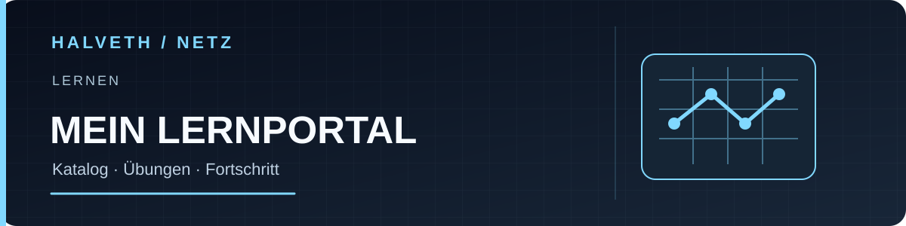

<!-- HUB_LANGUAGES_V1 -->
[Original / Deutsch](README.md) · [English](README.en.md) · [Русский](README.ru.md)
<!-- /HUB_LANGUAGES_V1 -->

# Mein Lernportal – 702 Lektionen zum direkten Loslernen

**Öffnen. Suchen. Lernen.** Der freie, statische Katalog enthält 702 Lektionen in 13 Themenwelten. Lektionen, Suche und Übungen sind ohne Pflichtkonto direkt zugänglich; der Fortschritt liegt im Browser und kann exportiert oder importiert werden.

[**Lektionen direkt öffnen**](https://juri-halveth.github.io/mein-lernportal/) · [Bash-/Git-Labor](https://juri-halveth.github.io/mein-lernportal/big-bang/) · [Quellcode](https://github.com/Juri-Halveth/mein-lernportal/tree/main)



[Starship Lab als optionaler HALVETH-Überblick](https://juri-halveth.github.io/universum/)

## Was enthalten ist

- 702 eindeutige Lektionen und Quizze in 133 Lernstufen
- Einstieg und Alltag, künstliche Intelligenz, Machine Learning, HTML, Python, JavaScript, digitale Sicherheit, Mathematik, Marketing, SEO, Projekte, Server sowie anschauliche Mathematik
- lokale Fortschrittsanzeige mit Export, Import und Löschung
- Suche über Themenwelten und Lektionstitel
- interaktive Übungen, Quizze, Codeaufgaben und Visualisierungen
- responsive Oberfläche, Hell-/Dunkelmodus und reduzierte Bewegung

JavaScript- und Python-Übungen laufen in einem kurzlebigen Worker innerhalb eines getrennten Iframes mit undurchsichtiger Herkunft. Die Laufzeit besitzt keinen Zugriff auf das Dokument oder den lokalen Speicher des Portals. Ein Lauf endet spätestens acht Sekunden nach dem Laden; ein Seitenwechsel beendet ihn ebenfalls. Jede Ausführung startet neu.

Der Lernstand wird nur im Browser gespeichert. Python-Aufgaben laden Pyodide 0.26.2 erst beim Start einer solchen Aufgabe von jsDelivr; der normale Portalstart verwendet ausschließlich Dateien dieses Repositorys.

## Lokal öffnen

```powershell
npm ci --ignore-scripts
npm run serve
```

Danach: <http://127.0.0.1:4175/>

Die lokale Vorschau bindet ausschließlich Loopback und liefert eine ausdrückliche Liste öffentlicher Dateien. Git-Metadaten, Abhängigkeiten, Werkzeuge und neue private Dateien werden nicht ausgeliefert; fehlerhafte URL-Kodierungen erhalten eine Fehlerantwort.

## Prüfen

```powershell
npm test
```

Die Prüfung bindet den Inhaltssnapshot, zählt Tracks, Stufen und eindeutige Lektionen, prüft die produktiven HTML-Shells auf Zugangssperren und lädt die Oberfläche in einer Browser-DOM-Umgebung.

## Herkunft

Die Plattform wurde aus dem geprüften, kontofreien Lernstudio-Stand `8f171e7` aufgebaut. Der kanonische LF-Snapshot des veröffentlichten Curriculums ist mit SHA-256 `8c40f2071c6a2d67f91c6e759fe2c36de4877321e61001b51020376ffc693432` gebunden. Dieses Portal bleibt ein eigenständiger Snapshot. Das weiterentwickelte [Lernstudio](https://juri-halveth.github.io/lernstudio/) verwendet ebenfalls GitHub Pages ohne eigene bezahlte Domain.

## Lizenz

Originaler Plattformcode und veröffentlichte Originallektionen stehen unter der [ISC-Lizenz](LICENSE.txt). Separat lizenzierte Bestandteile sind in [THIRD_PARTY_NOTICES.txt](THIRD_PARTY_NOTICES.txt) aufgeführt.

## Getrennte Erweiterungen

Das [Bash-/Git-Labor und weitere Experimente](EXPERIMENTS.md) haben eine eigene
Übersicht. Der Einstieg dieses Repositorys bleibt der direkte Lernkatalog.

## Zusammenarbeit

Rückmeldungen zu einer konkreten Lektion sind in den
[Issues](https://github.com/Juri-Halveth/mein-lernportal/issues) willkommen.
Zusammenarbeit: [juri@halveth.de](mailto:juri@halveth.de).
